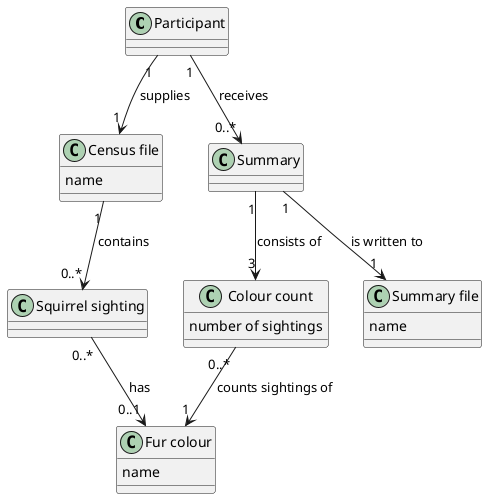

# Domain Model

## Metadata
| Key | Value |
| --- | --- |
| ID | DM-002 |
| CrossReference | [UC-001], [UCD-001], [SSD-001], [DICT-001] |
| Language | en |
| Domain | it |

## Version History
| Date | Status | Author | Reviewer | Change | Commit |
| --- | --- | --- | --- | --- | --- |
| 2026-10-13 | Accepted | Jens Tirsvad Nielsen | AI as stand-in for S01 | Initial version | [259d017] |

---

## Purpose and Scope

Covers: [UC-001] Count squirrels by fur colour.

## Diagram

Concepts, attributes and associations only — no operations.

## Concept Table

| Concept | Definition | Attributes | Source (use case / glossary) |
| --- | --- | --- | --- |
| Participant | The course participant who runs the program | - | [UC-001] primary actor |
| Census file | The file with the 2018 squirrel census | name | [UC-001] step 1, [DICT-001] |
| Squirrel sighting | One recorded observation of one squirrel | - | [UC-001] step 2, [DICT-001] |
| Fur colour | The primary fur colour of a squirrel: Gray, Cinnamon or Black | name | [UC-001] step 2, [DICT-001] |
| Colour count | The number of sightings with one fur colour | number of sightings | [UC-001] step 4, [DICT-001] |
| Summary | The table of colour counts | - | [UC-001] step 3, [DICT-001] |
| Summary file | The file the summary is written to | name | [UC-001] step 1, [DICT-001] |

## Association Table

| From | Association (reading direction) | To | Multiplicity |
| --- | --- | --- | --- |
| Participant | supplies | Census file | 1 to 1 |
| Census file | contains | Squirrel sighting | 1 to 0..* |
| Squirrel sighting | has | Fur colour | 0..* to 0..1 |
| Colour count | counts sightings of | Fur colour | 0..* to 1 |
| Summary | consists of | Colour count | 1 to 3 |
| Summary | is written to | Summary file | 1 to 1 |
| Participant | receives | Summary | 1 to 0..* |

## Generalizations

None.

---

[UC-001]: ./uc-001/uc.md
[UCD-001]: ./use-case-diagram.md
[SSD-001]: ./uc-001/ssd.md
[DICT-001]: ./dictionary.md
[259d017]: https://git.tirsystem.com/Tirsvad-Udemy-100-days-of-code/025-squirrel/commit/259d017ad257059330eb9a8bdbf940c9d082664e
