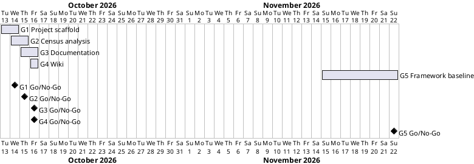

# Project Plan

## Metadata
| Key | Value |
| --- | --- |
| ID | PP-001 |
| CrossReference | [BC-001], [SA-001], [MIL-001], [MIL-002], [MIL-003], [MIL-004], [MIL-005], [US-001] |
| Language | en |
| Domain | education |

## Version History
| Date | Status | Author | Reviewer | Change | Commit |
| --- | --- | --- | --- | --- | --- |
| 2026-10-13 | Deprecated | Jens Tirsvad Nielsen | AI as stand-in for S01 | CrossReference: added [US-001] | [259d017] |
| 2026-10-13 | Deprecated | Jens Tirsvad Nielsen | AI as stand-in for S01 | Corrected the wiki folder `docs/wiki/` to `wiki/` | [d85cfe5] |
| 2026-11-15 | Accepted | Jens Tirsvad Nielsen | AI as stand-in for S01 | Added the baseline gateway G5 (MIL-005), its schedule row, scope coverage, dependency, risk and Gantt entries and the No-Go rule; corrected the wiki folder in the wiki risk to `docs/wiki/`; added an open issue about the baseline; set the domain to education; reviewed in autonomous mode, not independent | pending |
---

## Purpose

This plan schedules the four phases that deliver the squirrel census assignment: tooling, analysis, documentation and wiki publication. It schedules them against the Business Case constraint of one pull request per milestone and a single-day effort. A fifth gateway, [MIL-005], was added on 2026-11-15 to bring the finished project to the baseline of the framework; it runs from 2026-11-15 to 2026-11-22.

## Planning Assumptions

- Week 1 starts 2026-10-13 (the day of the plan); the plan ends by 2026-10-16.
- Phase length: one day per phase.
- One branch and one pull request per milestone, each closing the issues of its tasks ([BC-001] Constraints).
- The Product Owner and reviewer is S01 for every phase ([SA-001]); in autonomous mode the AI acts as stand-in and records it in each review record.
- The plan is accepted by S01 in chat; the Project Plan has no quality control (QC) checklist.
- The baseline gateway [MIL-005] starts 2026-11-15 and ends by 2026-11-22, one week (source: [BC-001], Assumptions). The end date of the plan moves from 2026-10-16 to 2026-11-22 because of it; the reason is the agreed minimum quality baseline of the framework.
- For [MIL-005] S01 has authorised the assistant to commit, push, open the pull request and merge it, and the review is done by an AI stand-in for S01 (source: [BC-001], Constraints; [SA-001], Conflicting Interests and Mitigations).

## Gateway Schedule

| Gateway | Document | Window | Decision date | Owner | Stories | Main deliverable | Milestone |
| --- | --- | --- | --- | --- | --- | --- | --- |
| G1 Project scaffold and tooling | [MIL-001] | 2026-10-13 to 2026-10-14 | 2026-10-14 | S01 | none | `.gitignore`, `pyproject.toml`, constants, Doxyfile, continuous integration (CI), repository metadata | [Milestone 124][MS-124] |
| G2 Squirrel census analysis | [MIL-002] | 2026-10-14 to 2026-10-15 | 2026-10-15 | S01 | US-001 | Package, tests, census file, `squirrel_count.csv` | [Milestone 125][MS-125] |
| G3 README, source documentation and screenshots | [MIL-003] | 2026-10-15 to 2026-10-16 | 2026-10-16 | S01 | none | README, Doxygen comments, screenshots | [Milestone 126][MS-126] |
| G4 Wiki and publication | [MIL-004] | 2026-10-16 | 2026-10-16 | S01 | none | Wiki in en, da and ms | [Milestone 127][MS-127] |
| G5 Framework baseline | [MIL-005] | 2026-11-15 to 2026-11-22 | 2026-11-22 | S01 | none | The framework release, the wiki in `docs/wiki/`, the README in the framework template, the licence metadata and the review records | [Milestone 534][MS-534] |



## Scope Coverage

| Business Case scope item | Gateway |
| --- | --- |
| Reading the census file and counting by primary fur colour | G2 |
| Summary table exported as `squirrel_count.csv` | G2 |
| Command line entry point, `constants.py`, `pyproject.toml`, `.gitignore`, tests, CI | G1 and G2 |
| Doxygen comments, `Doxyfile`, build instructions | G1 and G3 |
| README, screenshots | G3 |
| Three-language wiki | G4 |
| Repository description and topics | G1 (set) and G4 (verified) |
| The baseline: framework release, wiki location, README template, licence metadata, review records | G5 |

## Dependencies

```
G1 -> G2 -> G3 -> G4 -> G5
```

A No-Go at a gateway stops the later gateways; their dates move by the days the rework takes. A No-Go on G5 ([MIL-005]) leaves the program and the earlier gateways as they are; S01 decides the new date.

## Plan Risks

| Risk | Impact | Mitigation |
| --- | --- | --- |
| CI runner is not available on the git host | The CI workflow cannot be shown green | Run the same commands locally and report the missing runner |
| Wiki repository cannot be pushed | G4 deliverable is not published | Keep the pages under `docs/wiki/` and report it |
| Doxygen is not installed locally | The documentation build cannot be verified | Report as not verified; document the command |
| A continuous integration (CI) check fails on the pull request of [MIL-005] | The merge is delayed past 2026-11-22 | The failure is fixed on the same branch and the checks run again; after three failed rounds on one cause the work stops and S01 decides (trace: success criterion 6 of [BC-001]) |

## Open Issues

- The repository URL in the request (`Tirsvad-Udemy-100_days_of_code`) differs from `origin` (`Tirsvad-Udemy-100-days-of-code/025-squirrel`); the plan follows `origin`.
- The census file (730 kilobytes) is assumed to be committed under `data/`; S01 can veto this at plan acceptance.
- The lecture uses Pandas; the plan uses the standard library to keep zero runtime dependencies (ADR-0001, [SA-001] conflict list).
- Framework baseline (closed in [MIL-005]): the wiki pages moved from `wiki/` to `docs/wiki/`, the location the framework requires, and the Danish and Malay pages are named `Home-da` and `Home-ms`. [MIL-004], [BC-001] and the review records RC-026 and RC-027 still say `wiki/`, as they were accepted. The older wiki pages named `Home.da` and `Home.ms` (and the other pages of the same naming) stay on the git host; this project does not delete them. The domain of the Business Case, Stakeholder Analysis, Project Plan, dictionary and milestones is now `education`; the use case documents, the user story, the system sequence diagram and the domain models keep the domain `it`, as they were accepted and are not changed.

---

[BC-001]: ./business-case.md
[SA-001]: ./stakeholder-analysis.md
[MIL-001]: ./milestones/mil-001-project-scaffold.md
[MIL-002]: ./milestones/mil-002-census-analysis.md
[MIL-003]: ./milestones/mil-003-documentation.md
[MIL-004]: ./milestones/mil-004-wiki-publication.md
[MS-124]: https://git.tirsystem.com/Tirsvad-Udemy-100-days-of-code/025-squirrel/milestone/124
[MS-125]: https://git.tirsystem.com/Tirsvad-Udemy-100-days-of-code/025-squirrel/milestone/125
[MS-126]: https://git.tirsystem.com/Tirsvad-Udemy-100-days-of-code/025-squirrel/milestone/126
[MS-127]: https://git.tirsystem.com/Tirsvad-Udemy-100-days-of-code/025-squirrel/milestone/127
[US-001]: ./user-stories.md
[259d017]: https://git.tirsystem.com/Tirsvad-Udemy-100-days-of-code/025-squirrel/commit/259d017ad257059330eb9a8bdbf940c9d082664e
[d85cfe5]: https://git.tirsystem.com/Tirsvad-Udemy-100-days-of-code/025-squirrel/commit/d85cfe5c4b62b2e1759f1c47b25bdb787ba6fd68
[MIL-005]: ./milestones/mil-005-framework-baseline.md
[MS-534]: https://git.tirsystem.com/Tirsvad-Udemy-100-days-of-code/025-squirrel/milestone/534
