# Project Plan

## Metadata
| Key | Value |
| --- | --- |
| ID | PP-001 |
| CrossReference | [BC-001], [SA-001], [MIL-001], [MIL-002], [MIL-003], [MIL-004], [US-001] |
| Language | en |
| Domain | it |

## Version History
| Date | Status | Author | Reviewer | Change | Commit |
| --- | --- | --- | --- | --- | --- |
| 2026-10-13 | Accepted | Jens Tirsvad Nielsen | S01 | Initial version | [f1b3c03] |
| 2026-10-13 | Proposed | Jens Tirsvad Nielsen | AI as stand-in for S01 | CrossReference: added [US-001] | pending |
---

## Purpose

This plan schedules the four phases that deliver the squirrel census assignment: tooling, analysis, documentation and wiki publication. It schedules them against the Business Case constraint of one pull request per milestone and a single-day effort.

## Planning Assumptions

- Week 1 starts 2026-10-13 (the day of the plan); the plan ends by 2026-10-16.
- Phase length: one day per phase.
- One branch and one pull request per milestone, each closing the issues of its tasks ([BC-001] Constraints).
- The Product Owner and reviewer is S01 for every phase ([SA-001]); in autonomous mode the AI acts as stand-in and records it in each review record.
- The plan is accepted by S01 in chat; the Project Plan has no quality control (QC) checklist.

## Gateway Schedule

| Gateway | Document | Window | Decision date | Owner | Stories | Main deliverable | Milestone |
| --- | --- | --- | --- | --- | --- | --- | --- |
| G1 Project scaffold and tooling | [MIL-001] | 2026-10-13 to 2026-10-14 | 2026-10-14 | S01 | none | `.gitignore`, `pyproject.toml`, constants, Doxyfile, continuous integration (CI), repository metadata | [Milestone 124][MS-124] |
| G2 Squirrel census analysis | [MIL-002] | 2026-10-14 to 2026-10-15 | 2026-10-15 | S01 | US-001 | Package, tests, census file, `squirrel_count.csv` | [Milestone 125][MS-125] |
| G3 README, source documentation and screenshots | [MIL-003] | 2026-10-15 to 2026-10-16 | 2026-10-16 | S01 | none | README, Doxygen comments, screenshots | [Milestone 126][MS-126] |
| G4 Wiki and publication | [MIL-004] | 2026-10-16 | 2026-10-16 | S01 | none | Wiki in en, da and ms | [Milestone 127][MS-127] |

```plantuml
@startgantt
Project starts 2026-10-13
[G1 Project scaffold] starts 2026-10-13 and ends 2026-10-14
[G2 Census analysis] starts 2026-10-14 and ends 2026-10-15
[G3 Documentation] starts 2026-10-15 and ends 2026-10-16
[G4 Wiki] starts 2026-10-16 and ends 2026-10-16
[G1 Go/No-Go] happens 2026-10-14
[G2 Go/No-Go] happens 2026-10-15
[G3 Go/No-Go] happens 2026-10-16
[G4 Go/No-Go] happens 2026-10-16
@endgantt
```



## Scope Coverage

| Business Case scope item | Gateway |
| --- | --- |
| Reading the census file and counting by primary fur colour | G2 |
| Summary table exported as `squirrel_count.csv` | G2 |
| Command line entry point, `constants.py`, `pyproject.toml`, `.gitignore`, tests, CI | G1 and G2 |
| Doxygen comments, `Doxyfile`, build instructions | G1 and G3 |
| README, screenshots | G3 |
| Three-language wiki | G4 |
| Repository description and topics | G1 (set) and G4 (verified) |

## Dependencies

```
G1 -> G2 -> G3 -> G4
```

A No-Go at a gateway stops the later gateways; their dates move by the days the rework takes.

## Plan Risks

| Risk | Impact | Mitigation |
| --- | --- | --- |
| CI runner is not available on the git host | The CI workflow cannot be shown green | Run the same commands locally and report the missing runner |
| Wiki repository cannot be pushed | G4 deliverable is not published | Keep the pages under `docs/wiki/` and report it |
| Doxygen is not installed locally | The documentation build cannot be verified | Report as not verified; document the command |

## Open Issues

- The repository URL in the request (`Tirsvad-Udemy-100_days_of_code`) differs from `origin` (`Tirsvad-Udemy-100-days-of-code/025-squirrel`); the plan follows `origin`.
- The census file (730 kilobytes) is assumed to be committed under `data/`; S01 can veto this at plan acceptance.
- The lecture uses Pandas; the plan uses the standard library to keep zero runtime dependencies (ADR-0001, [SA-001] conflict list).

---

[BC-001]: ./business-case.md
[SA-001]: ./stakeholder-analysis.md
[MIL-001]: ./milestones/mil-001-project-scaffold.md
[MIL-002]: ./milestones/mil-002-census-analysis.md
[MIL-003]: ./milestones/mil-003-documentation.md
[MIL-004]: ./milestones/mil-004-wiki-publication.md
[f1b3c03]: https://git.tirsystem.com/Tirsvad-Udemy-100-days-of-code/025-squirrel/commit/f1b3c034dc3880b7884646b4a4ed28e5f98fbcd3
[MS-124]: https://git.tirsystem.com/Tirsvad-Udemy-100-days-of-code/025-squirrel/milestone/124
[MS-125]: https://git.tirsystem.com/Tirsvad-Udemy-100-days-of-code/025-squirrel/milestone/125
[MS-126]: https://git.tirsystem.com/Tirsvad-Udemy-100-days-of-code/025-squirrel/milestone/126
[MS-127]: https://git.tirsystem.com/Tirsvad-Udemy-100-days-of-code/025-squirrel/milestone/127
[US-001]: ./user-stories.md
