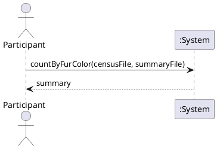
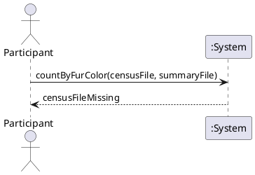

# System Sequence Diagram

## Metadata
| Key | Value |
| --- | --- |
| ID | SSD-001 |
| CrossReference | [UC-001] |
| Language | en |
| Domain | it |

## Version History
| Date | Status | Author | Reviewer | Change | Commit |
| --- | --- | --- | --- | --- | --- |
| 2026-10-13 | Accepted | Jens Tirsvad Nielsen | AI as stand-in for S01 | Initial version | [259d017] |

---

## Source Use Case

Count squirrels by fur colour ([UC-001]) — scenario: main success scenario. The alternate flow 1a (census file missing) is the second diagram; flow 2a has no system message of its own.

## Diagram

## System Operations

| Step | Message | Parameters | Return | Use case step |
| --- | --- | --- | --- | --- |
| 1 | countByFurColor | censusFile, summaryFile | summary (colour count of each fur colour) | 1 (input), 2 (count), 3 (write), 4 (shown to the participant) |
| 1a | countByFurColor | censusFile, summaryFile | censusFileMissing | 1a |

Steps 2 to 4 of the use case are the work of the system inside one operation: the system receives one message and returns one result, so one message covers steps 1 to 4.

## Lifecycle Notes

The system instance lives for one run of the program; nothing is kept between runs.

---

[UC-001]: ./uc.md
[259d017]: https://git.tirsystem.com/Tirsvad-Udemy-100-days-of-code/025-squirrel/commit/259d017ad257059330eb9a8bdbf940c9d082664e
