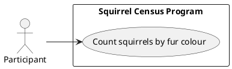

# Use Case Diagram

## Metadata
| Key | Value |
| --- | --- |
| ID | UCD-001 |
| CrossReference | [SA-001], [BC-001] |
| Language | en |
| Domain | it |

## Version History
| Date | Status | Author | Reviewer | Change | Commit |
| --- | --- | --- | --- | --- | --- |
| 2026-10-13 | Accepted | Jens Tirsvad Nielsen | AI as stand-in for S01 | Initial version | [259d017] |

---

## Purpose and Scope

The system is the squirrel census program. The boundary contains the one goal of the assignment: counting squirrels by fur colour from the census file and writing the summary. The participant is the only actor.

## Diagram

## Actor Table

| Actor | Stereotype | Stakeholder ID (SA) | Goals (use cases) |
| --- | --- | --- | --- |
| Participant | <<Actor>> | S01, S02 | Count squirrels by fur colour |
| Squirrel Census Program | <<System>> | S01 | - |

## Use Case Table

| Use Case | Actor(s) | Goal |
| --- | --- | --- |
| Count squirrels by fur colour | Participant | Get the number of squirrels of each fur colour as a summary file |

## Relationships

| From | Relationship (`<<include>>` / `<<extend>>`) | To | Justification |
| --- | --- | --- | --- |
| - | - | - | There is only one use case, so there is no include or extend relationship |

---

[SA-001]: ./stakeholder-analysis.md
[BC-001]: ./business-case.md
[259d017]: https://git.tirsystem.com/Tirsvad-Udemy-100-days-of-code/025-squirrel/commit/259d017ad257059330eb9a8bdbf940c9d082664e
